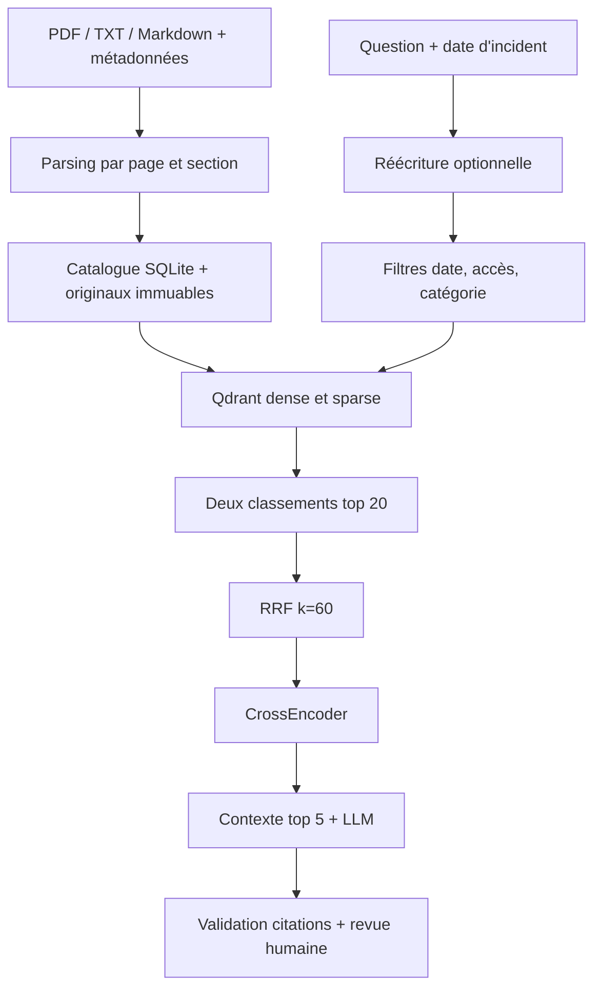

# Architecture technique

Le Level 1 constitue un seul moteur partagé par CLI, API et MCP. Le Level 2 devra l'appeler sans recréer d'index ou de chaîne de recherche indépendante.

## Modules et responsabilités

| Chemin | Responsabilité |
|---|---|
| `models.py` | Schémas Pydantic, bornes d'entrée, références |
| `ingestion/pipeline.py` | PyPDFLoader, PDF/TXT/MD, nettoyage conservateur, split sections puis récursif, tableaux PDF |
| `storage/catalog.py` | Déduplication, versions immuables, absence de chevauchement, désactivation auditée, comparaison |
| `indexing/qdrant.py` | Named vectors, SentenceTransformer dense, FastEmbedSparse BM25, filtres Qdrant |
| `retrieval/fusion.py` | RRF déterministe, classement à partir du rang 1, déduplication |
| `retrieval/engine.py` | E1–E4, traces complètes, reranking Query–Chunk |
| `prompts/rag.py` | ChatPromptTemplate, LCEL, modèle configurable, sorties structurées, contrôle citations |
| `training/finetune.py` | Fine-tuning réel, validation, checkpoints et empreintes des splits |
| `evaluation/metrics.py`, `scripts/evaluate.py` | Recall, MRR, precision, nDCG, latence, résultats par question |
| `mcp/` | SDK MCP officiel, client stdio et outils de recherche documentaire |

## Choix techniques

Python 3.12 est la version de validation. SQLite convient à une démonstration locale et permet les transactions ; un stockage partagé demanderait un service dédié. Qdrant local in-process est un vrai index Qdrant et permet un test sans Docker. Le mode serveur reste configurable. Le modèle dense est celui du cours ; le reranker multilingue est également celui du lab 16. BM25 utilise FastEmbedSparse `Qdrant/bm25` avec IDF Qdrant. LangChain compose les prompts/LLM ; Qdrant SDK permet des scores séparés et des filtres précis.

La réindexation reconstruit une collection dérivée du catalogue ; le catalogue est la source d'autorité. Chaque version possède un intervalle `[effective_date,effective_until[`. Une désactivation exclut volontairement la version des recherches courantes, même historiques, mais conserve les originaux et événements. Les politiques expirées restent disponibles pour les incidents correspondant à leur intervalle. Une modification du contenu à version identique est refusée.

Les chunks de préambule restent indexés et sont des distracteurs du benchmark, mais ne constituent pas des règles annotées. Les numéros de page PDF sont physiques, à partir de 1. TXT/MD ont une page par segment form-feed ; la page 1 d'un Markdown n'est pas une pagination de PDF inventée.

## Sécurité et frontières

Les textes de plainte et de politique sont des données non fiables. Les citations doivent référencer un chunk récupéré et contenir un extrait exact. Cette vérification empêche les références fabriquées ; elle ne prouve pas l'implication logique entre une phrase générée et sa citation. Une vérification humaine reste nécessaire.

Le service local ne contient aucun outil de paiement, sanction ou envoi de message. Les futurs comptes humains doivent être authentifiés côté serveur avec permissions sur les dossiers et événements append-only. Les filtres d'accès ne doivent jamais provenir d'une suggestion du LLM. Les identifiants clients ne quittent pas l'audit local. Aucune clé n'est versionnée. Les exceptions exposées à une API ne doivent pas inclure prompts, pièces jointes ou secrets.

## Contrats Level 2 (à développer après validation Level 1)

`Complaint` : id UUID, tenant_id, owner_id, session_id, texte expurgé, incident_date, created_at. `Fact` : type, valeur, provenance, statut declared/verified/contradicted/unknown, verified_by, timestamp. `Analysis` : complaint_id, modèle/version, snapshot des références (hash/version/page/section/chunk), conditions, inconnues, statut provisoire. `ReviewDecision` : reviewer_id, décision, justification, timestamp, analysis_id. `AuditEvent` : identité, action, état antérieur/nouveau, timestamp.

Le moteur déterministe devra comparer les conditions explicites avec les seuls faits vérifiés. Le LLM extraira des déclarations et expliquera les ambiguïtés, sans transformer une déclaration en preuve. Les décisions humaines et les recommandations auront des champs distincts. Les brouillons FR/EN seront modifiables et aucun envoi ne sera automatique.

Pages Streamlit prévues : dashboard, dépôt de plainte, analyse, base documentaire, historique, explication RAG, évaluation. L'interface académique peut visualiser les résultats ; la validation humaine métier ne sera déclarée fonctionnelle qu'après ses tests d'autorisation et de persistance.
