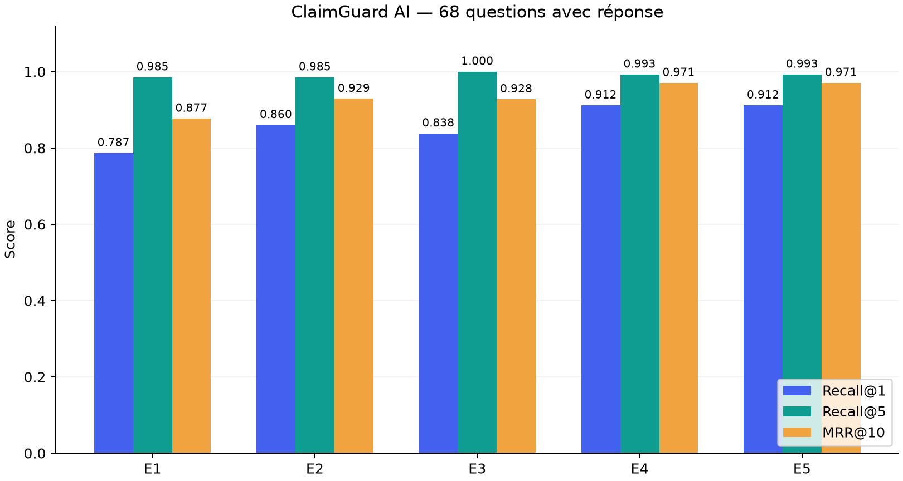
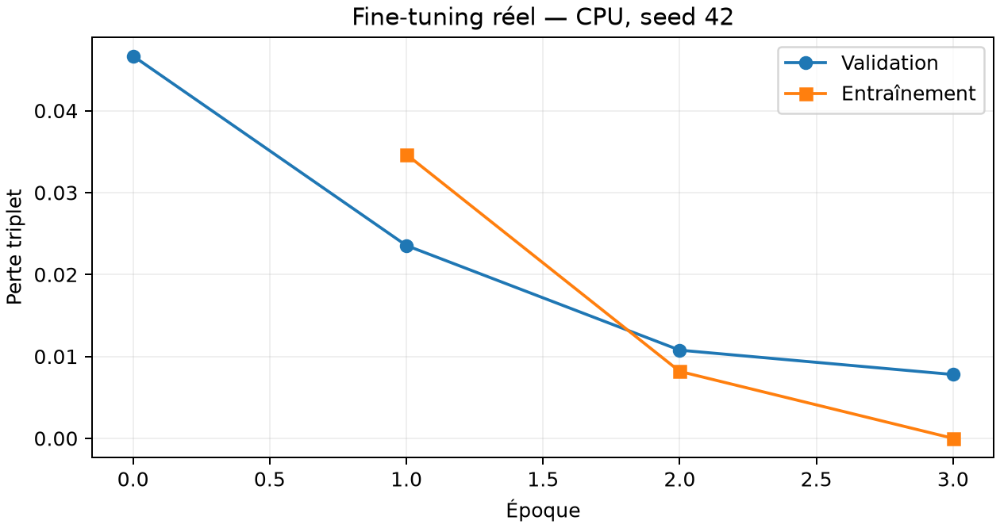

# Résultats expérimentaux — ClaimGuard AI

Exécution du 2 novembre 2026. Corpus fictif NovaRetail : 11 versions documentaires, 44 chunks dont les préambules. Test : 76 questions, dont 68 avec réponse et 8 sans réponse. Annotation par l’auteur, contrôle automatique des références, sans revue humaine indépendante.

| Expérience | Recall@1 | Recall@3 | Recall@5 | Recall@10 | MRR@10 | Latence moyenne ms |
|---|---:|---:|---:|---:|---:|---:|
| E1 | 0.7868 | 0.9118 | 0.9853 | 1.0000 | 0.8771 | 11.02 |
| E2 | 0.8603 | 0.9559 | 0.9853 | 0.9853 | 0.9289 | 1.25 |
| E3 | 0.8382 | 0.9853 | 1.0000 | 1.0000 | 0.9277 | 13.13 |
| E4 | 0.9118 | 0.9779 | 0.9926 | 1.0000 | 0.9706 | 425.42 |
| E5 | 0.9118 | 0.9779 | 0.9926 | 1.0000 | 0.9706 | 412.30 |

E1 : dense ; E2 : BM25 ; E3 : dense + BM25 + RRF ; E4 : hybride + CrossEncoder ; E5 : embeddings fine-tunés + hybride + même CrossEncoder.

## Lecture des résultats
- E3 atteint Recall@5 = 1,0000. Le reranker améliore le premier résultat et le MRR, mais réduit légèrement Recall@5 à 0,9926. Il n’est donc pas meilleur sur tous les critères.
- E4 et E5 produisent les mêmes métriques agrégées : aucune amélioration de la chaîne complète n’est démontrée par ce fine-tuning.
- Le petit corpus et les candidats top-20 laissent une grande partie du classement final au CrossEncoder. Un résultat élevé sur ce corpus ne constitue pas une validation sur des plaintes réelles.
- Les latences sont des mesures locales CPU avec modèles déjà chargés ; elles excluent le chargement et les appels LLM, et ne constituent pas un test de charge. Les différences E4/E5 ne prouvent pas un gain de vitesse.

## Fine-tuning
Base : sentence-transformers/all-MiniLM-L6-v2. Triplet cosine margin 0,25 ; 3 époques ; batch 8 ; lr 2e-5 ; weight decay 0,01 ; seed 42 ; CPU. 60 exemples train, 30 validation. Checkpoint retenu : époque 3, choisi sur validation uniquement. Durée mesurée : 14.45 s.

## Comparaison du modèle dense seul
| Modèle | Recall@1 | Recall@5 | MRR@10 |
|---|---:|---:|---:|
| Pré-entraîné | 0.7868 | 0.9853 | 0.8771 |
| Fine-tuné | 0.7721 | 0.9706 | 0.8710 |

Cette comparaison isole les embeddings. Aucun hyperparamètre n’a été ajusté après observation du test.

## Échecs et limites
Q021 : une contestation de scan « livré » remonte après la règle de retard. Q033 : une demande en français remonte après l’accusé de réception. Q040 : le contrôle d’accès de l’enquête remonte après la règle de conduite. Q061 : le cas multithématique échange + comportement classe d’abord une règle de rupture de stock. Les classements complets figurent dans retrieval_results.json.

Les 8 questions sans réponse ont été soumises aux retrieveurs, mais aucune précision d’abstention n’est annoncée : elle exige la génération LLM réelle. Faithfulness et implication logique des citations ne sont pas mesurées. Le test ne couvre pas suffisamment le français, les très longs documents, les scans, les politiques réelles contradictoires ni les attaques adversariales.

## Preuves et reproductibilité
- `retrieval_results.json` : scores et classements par question, SHA du test, temps.
- `dense_finetuning_comparison.json` : ablation dense seule.
- `training_run.json` : hyperparamètres, pertes, SHA des trois splits.
- `checkpoint_manifest.json` : fichiers du checkpoint et SHA-256.
- `pytest_results.xml`, `tests_final.txt` : 16 tests réussis, dont modèles réels et Qdrant local.
- `mcp_demo.json` : trois outils découverts et trois appels client–serveur réussis.
- `streamlit_interaction.txt` : formulaire de recherche et cinq cartes sources vérifiés avec Streamlit AppTest.
- `live_rag_check.txt` : blocage explicite dû à l’absence de GROQ_API_KEY.
- `environment-linux.lock.txt` : environnement complet observé ; Windows et Docker non exécutés.
