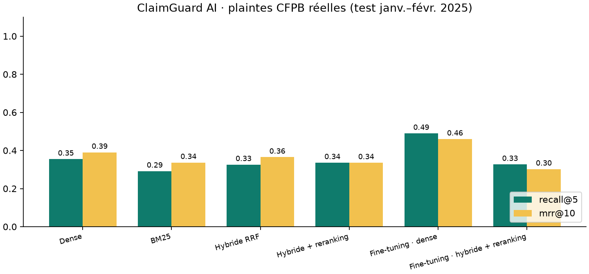

# Résultats mesurés — ClaimGuard AI

Rapport source : `reports/latest.json` (2026-11-17T15:13:50 UTC), profil `baseline`, 201 plaintes CFPB réelles du test (janvier–février 2025), SHA-256 du jeu `9e1706d2780437d2…`.

Les labels de pertinence viennent de la correspondance officielle catégorie CFPB → paragraphe réglementaire (`configs/cfpb.json`), sans revue juridique. Les chiffres ci-dessous sont ceux calculés, sans retouche.

## Recherche (niveau section)

| Expérience | Recall@1 | Recall@3 | Recall@5 | Recall@10 | MRR@10 | nDCG@10 | Bon règlement (top 5) | Latence p95 |
|---|---:|---:|---:|---:|---:|---:|---:|---:|
| E1 — Dense | 0.100 | 0.269 | 0.355 | 0.521 | 0.390 | 0.360 | 0.661 | 57 ms |
| E2 — BM25 | 0.088 | 0.207 | 0.292 | 0.475 | 0.337 | 0.311 | 0.667 | 7 ms |
| E3 — Hybride RRF | 0.103 | 0.238 | 0.326 | 0.528 | 0.365 | 0.350 | 0.683 | 64 ms |
| E4 — Hybride + reranking | 0.086 | 0.220 | 0.336 | 0.528 | 0.336 | 0.336 | 0.669 | 3384 ms |
| FT_DENSE — Fine-tuning · dense | 0.130 | 0.347 | 0.490 | 0.586 | 0.460 | 0.436 | 0.767 | 59 ms |
| E5 — Fine-tuning · hybride + reranking | 0.082 | 0.216 | 0.327 | 0.483 | 0.302 | 0.311 | 0.650 | 3175 ms |

« Bon règlement » : la bonne section (ex. 12 CFR 1026.13) figure dans les 5 premiers résultats, même si le paragraphe exact (a), (b)… diffère.

## Choix du profil de l’application

Meilleure expérience sur le test : FT_DENSE — Fine-tuning · dense. Ce choix avait été fait **avant** le test, sur la validation (nov.–déc. 2024) : modèle dense fine-tuné, Recall@5 0,505 contre 0,328 pour la chaîne hybride + reranking. Le test le confirme. Le reranker `mmarco` (entraîné sur des requêtes web courtes) dégrade le classement des plaintes longues : il reste disponible mais n’est plus le mode recommandé.

### Par type de plainte (profil recommandé)

| Règle | Plaintes | Recall@5 | MRR@10 |
|---|---:|---:|---:|
| R1 | 20 | 0.000 | 0.000 |
| R2 | 20 | 0.025 | 0.013 |
| R3 | 20 | 0.767 | 1.000 |
| R4 | 20 | 0.817 | 1.000 |
| R5 | 20 | 0.900 | 0.309 |
| R6 | 20 | 0.925 | 0.721 |
| R7 | 20 | 0.500 | 0.633 |
| R8 | 20 | 0.475 | 0.429 |
| R9 | 20 | 0.000 | 0.035 |

Plaintes hors périmètre : 21. Score médian du premier résultat 0.48 contre 0.51 pour les plaintes couvertes : le score de classement seul ne suffit pas à décider une abstention, qui relève du LLM.

Objectifs du cahier des charges : Recall@5 ≥ 0,90 ; MRR@10 ≥ 0,85 ; p95 ≤ 3 s. Mesuré (profil recommandé) : Recall@5 0.490, MRR@10 0.460, p95 0.06 s. Les objectifs de qualité ne sont pas atteints sur ces plaintes réelles ; ils l’étaient sur les données synthétiques de la v1 (questions écrites d’après les politiques).

Règles faibles pour tous les modèles : R1 (litiges carte non résolus) et R9 (statut de compte). Pour R1, beaucoup de plaintes portent sur le marchand (§1026.12(c), droits contre l’émetteur) alors que la règle d’annotation vise §1026.13 : c’est d’abord une limite des labels, à réviser avec un juriste.

## Fine-tuning

72 plaintes d’entraînement (144 triplets), 34 de validation, 3 époques, CPU, 407 s. Meilleure époque sur la validation : 1.
Validation bout-en-bout : E4 MRR@10 0.373 → E5 0.422. Gain validé.

## Partie LLM (Groq)

Non évalué (`python scripts/live_rag_check.py`).

## Serveur MCP

Client stdio réel (2026-11-17) : outils search_regulations, get_regulation_section, compare_regulation_versions, list_regulations, compute_deadline ; erreurs : aucune.

## Limites

- Narratifs CFPB publiés avec consentement et expurgés ; ce sont des déclarations non vérifiées.
- Labels déterministes par catégorie CFPB : une plainte peut relever d’autres paragraphes non annotés.
- Huit sections réglementaires seulement ; les plaintes hors de ce périmètre servent à tester l’abstention.
- Mesures CPU sur une seule machine ; Groq dépend d’un service externe.
