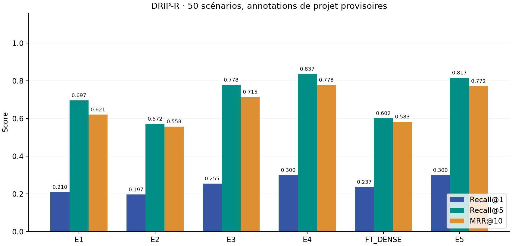
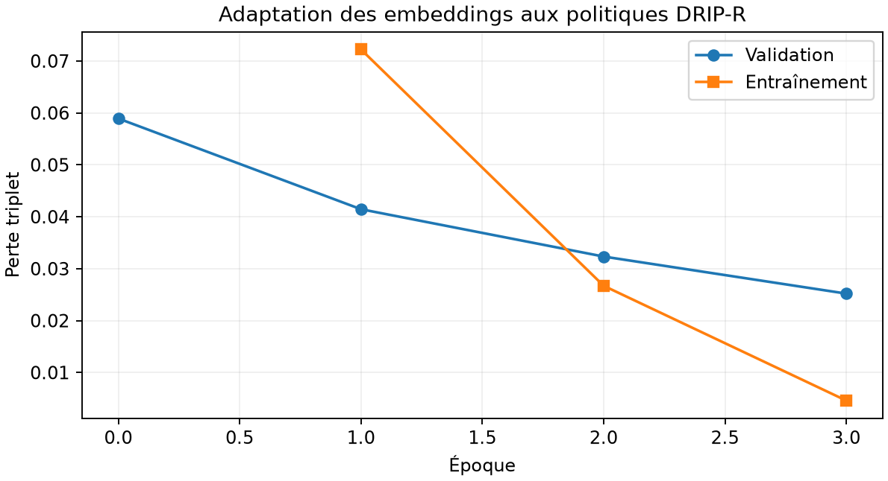

# ClaimGuard AI — résultats DRIP-R

Source : `hsuvaskakoty/DRIP-R`, révision `02f4c696df2a9170c3bea254ed2d60ea14bd4be4`. Exécution du 2 novembre 2026.

## Données et protocole
400 scénarios synthétiques, issus de 40 situations et de 10 profils. Deux textes de politiques uniques sont conservés octet pour octet, divisés en 30 sections locales. Les numéros de sections et la version 1.0 sont ajoutés par le projet. Les dates de validité et la pagination PDF originales sont inconnues.

Le test annoté contient 50 scénarios originaux (40 situations, 10 profils équilibrés) et 8 questions sans réponse créées pour le projet. Les labels de pertinence ont été rédigés par le modèle assistant avant les expériences, sans revue humaine indépendante. Ce ne sont pas les annotations humaines de DRIP-R, qui ne sont pas publiées.

Les requêtes ne contiennent que le message client et le résumé destiné à l’agent. Le détail de la situation, les ambiguïtés attendues et les informations privées du simulateur sont exclus. Le champ explicite task_id est utilisé pour regrouper les variantes.

## Mesures réellement calculées

| Expérience | Recall@1 | Recall@3 | Recall@5 | Recall@10 | MRR@10 | Latence moyenne (ms) |
|---|---:|---:|---:|---:|---:|---:|
| E1 | 0.2100 | 0.5083 | 0.6967 | 0.9167 | 0.6209 | 29.73 |
| E2 | 0.1967 | 0.4367 | 0.5717 | 0.8350 | 0.5580 | 1.46 |
| E3 | 0.2550 | 0.6300 | 0.7783 | 0.9067 | 0.7145 | 30.91 |
| E4 | 0.3000 | 0.6500 | 0.8367 | 0.8983 | 0.7783 | 2426.48 |
| FT_DENSE | 0.2367 | 0.4667 | 0.6017 | 0.7917 | 0.5832 | 27.59 |
| E5 | 0.3000 | 0.6200 | 0.8167 | 0.8883 | 0.7723 | 2454.32 |

E1 : dense ; E2 : BM25 ; E3 : RRF ; E4 : hybride et CrossEncoder ; FT_DENSE : embeddings adaptés seuls ; E5 : embeddings adaptés, hybride et même CrossEncoder.

Les moyennes par situation (40 groupes, poids égal par task_id) sont aussi enregistrées dans retrieval_results.json. La latence est locale CPU, hors chargement des modèles et hors LLM. Les références répétées à une même section ne sont comptées qu’une fois.

## Fine-tuning
Entraînement réel : 3 époques, 60 questions rédigées pour le projet et 30 autres pour validation ; perte triplet cosine (marge 0,25), batch 8, lr 2e-5, seed 42, CPU. Durée : 64.12 secondes. Checkpoint retenu : époque 3, choisi sur validation.

Aucun des 400 scénarios originaux n’a servi à entraîner les embeddings. L’entraînement adapte le modèle au texte des politiques ; il ne constitue pas un entraînement supervisé aux décisions de remboursement. Les politiques sont partagées entre entraînement et test : aucune généralisation à des politiques inconnues n’est revendiquée.

Variation du MRR dense : 0.6209 → 0.5832.
Variation du MRR de la chaîne complète : 0.7783 → 0.7723.

Ces observations portent uniquement sur ce petit benchmark annoté provisoirement. Aucun réglage n’est sélectionné sur les résultats du test.

La baisse de la perte de validation ne garantit pas une amélioration du classement des réclamations. Le modèle pré-entraîné reste le défaut de l’application ; le checkpoint adapté est conservé pour la comparaison académique.

## Échecs observés (E4)

- DRIP-Q015 : Recall@5=0.333. Attendu : DRIP-001@1.0#1.15, DRIP-001@1.0#1.8, DRIP-001@1.0#1.11. Classement : DRIP-002@1.0#2.3, DRIP-001@1.0#1.1, DRIP-001@1.0#1.6, DRIP-001@1.0#1.8, DRIP-002@1.0#2.6.
- DRIP-Q028 : Recall@5=0.333. Attendu : DRIP-001@1.0#1.14, DRIP-001@1.0#1.20, DRIP-001@1.0#1.8. Classement : DRIP-001@1.0#1.8, DRIP-001@1.0#1.5, DRIP-001@1.0#1.21, DRIP-001@1.0#1.1, DRIP-001@1.0#1.1.
- DRIP-Q008 : Recall@5=0.500. Attendu : DRIP-001@1.0#1.1, DRIP-001@1.0#1.8, DRIP-001@1.0#1.14, DRIP-001@1.0#1.20. Classement : DRIP-001@1.0#1.21, DRIP-001@1.0#1.1, DRIP-001@1.0#1.8, DRIP-001@1.0#1.1, DRIP-001@1.0#1.5.
- DRIP-Q009 : Recall@5=0.500. Attendu : DRIP-001@1.0#1.15, DRIP-001@1.0#1.8. Classement : DRIP-001@1.0#1.1, DRIP-001@1.0#1.21, DRIP-001@1.0#1.8, DRIP-001@1.0#1.5, DRIP-001@1.0#1.1.
- DRIP-Q011 : Recall@5=0.500. Attendu : DRIP-001@1.0#1.15, DRIP-001@1.0#1.8. Classement : DRIP-001@1.0#1.8, DRIP-001@1.0#1.1, DRIP-001@1.0#1.5, DRIP-001@1.0#1.21, DRIP-002@1.0#2.8.
- DRIP-Q016 : Recall@5=0.500. Attendu : DRIP-001@1.0#1.8, DRIP-001@1.0#1.7. Classement : DRIP-001@1.0#1.8, DRIP-001@1.0#1.6, DRIP-001@1.0#1.5, DRIP-002@1.0#2.2, DRIP-001@1.0#1.1.
- DRIP-Q026 : Recall@5=0.500. Attendu : DRIP-001@1.0#1.8, DRIP-001@1.0#1.1. Classement : DRIP-001@1.0#1.5, DRIP-001@1.0#1.8, DRIP-001@1.0#1.21, DRIP-002@1.0#2.5, DRIP-002@1.0#2.4.
- DRIP-Q030 : Recall@5=0.500. Attendu : DRIP-001@1.0#1.1, DRIP-001@1.0#1.6. Classement : DRIP-001@1.0#1.8, DRIP-001@1.0#1.21, DRIP-001@1.0#1.1, DRIP-001@1.0#1.17, DRIP-001@1.0#1.19.

## Limites et éléments non validés
- Deux documents seulement et beaucoup de questions sur les mêmes clauses générales : benchmark peu représentatif d’une grande entreprise.
- Les tableaux des exceptions et de certains frais sont incomplets dans les sources. Aucun montant, catégorie ou condition manquante n’a été inventé.
- Les déclarations clients ne sont pas des faits vérifiés ; aucune décision de conformité ou de remboursement n’est produite par le batch.
- Les 8 questions sans réponse sont exclues des moyennes de retrieval. Aucune précision d’abstention, qualité sémantique des citations ou faithfulness n’est annoncée.
- GROQ_API_KEY absente : réécriture et génération LLM réelles non validées. Le code est disponible via scripts/live_rag_check.py --corpus drip_r.
- Les politiques DRIP-R sont des instantanés fournis par le benchmark, pas une preuve des règles Amazon actuelles ni une source à fusionner avec les politiques NovaRetail.
- Les fonctions métier avancées de Level 2 restent en attente de validation du socle LLM.

## Preuves
audit.json, annotation_manifest.json, retrieval_results.json, training_run.json, checkpoint_manifest.json, mcp_demo.json et pytest_results.xml. Le jeu de test est identifié par son SHA-256 dans les rapports.

## Traitement du dataset complet
Les 400 scénarios ont été soumis à la recherche hybride avec reranking. Durée CPU mesurée hors chargement : 1051.67 secondes. Les cinq passages par scénario, leurs scores, références, lignes et empreintes figurent dans scenario_retrieval.jsonl.

Il s’agit de preuves récupérées, sans génération LLM, sans utilisation des informations privées et sans décision de conformité. Aucun score supervisé n’est attribué aux 350 scénarios non annotés.
